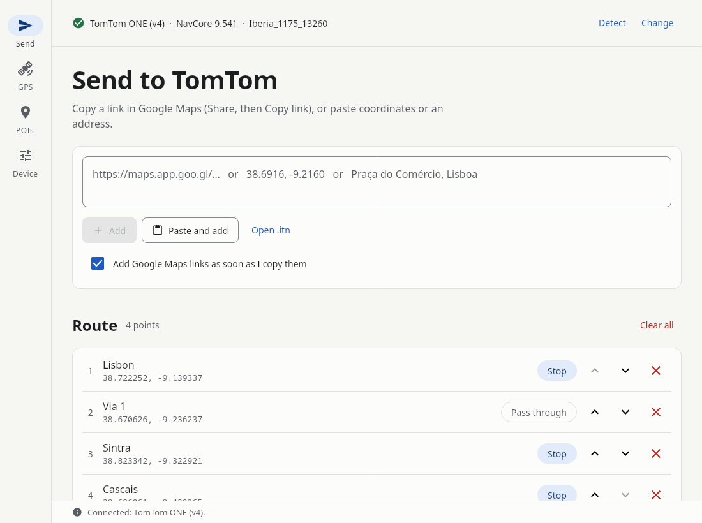
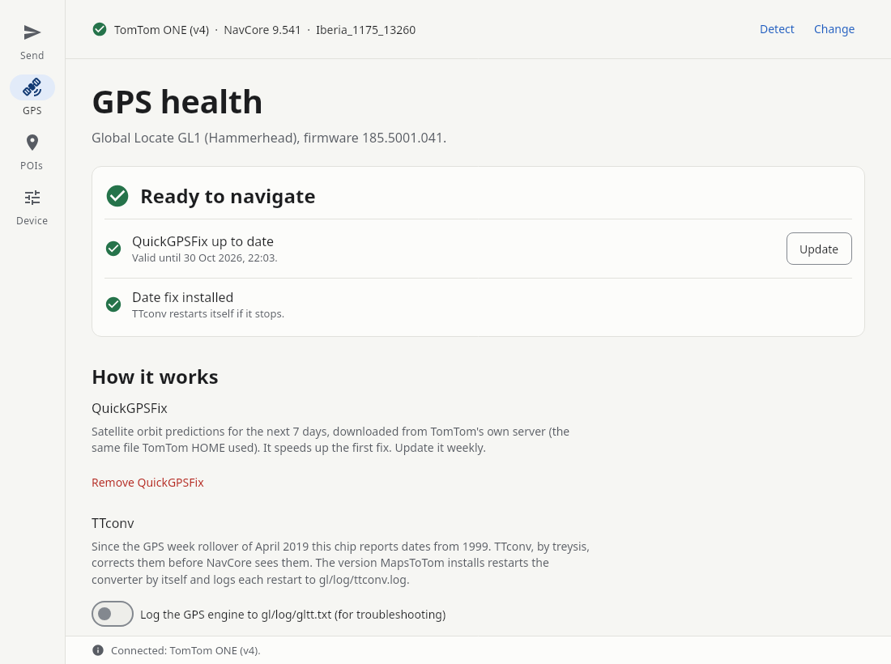
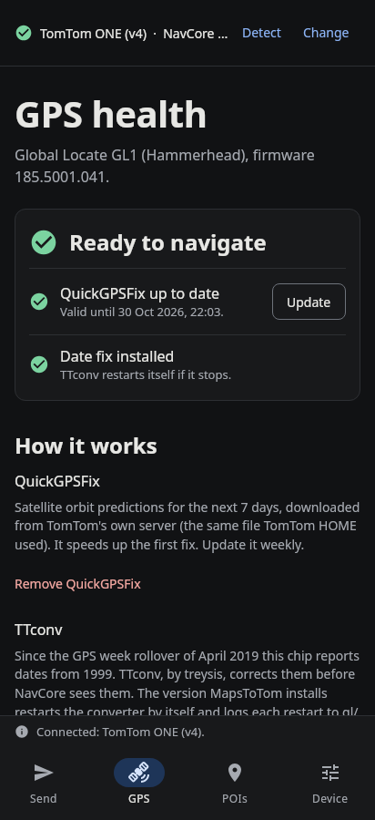

# MapsToTom
Maps to Tom was created in order to give old Tomtom Nav2 GPS the possibility to receive places and routes from Google Maps or ViaMichelin.
Later on the following features were added:
- Update gpsfix
- Add POIs from Openstreemap, Overture, Foursquare, a Garmin GPI file, a .ov2 file or a google maps list
- Offer known patches for gps rollover
- Offer improved accuracy and faster gps fix times with patched navcore
    
For TomTom ONE, XL, GO and Rider models that show up as a USB drive with a `ttgo.bif` file
(NavCore 8 and 9). Built and tested with a TomTom ONE v4 running NavCore 9.541.

One app for **Windows, macOS, Linux and Android**, with the same screens everywhere. 
<p>
  
  
</p>
<p></p>

## Get it

Download the latest version from the [Releases page](https://github.com/skinnie/MapsToTom/releases)
(GitHub builds these files when a version is tagged; until the first one, [build it yourself](#build-it-yourself)):

| System | File | Notes |
|---|---|---|
| Windows | `MapsToTom-x.y.z.msi` | Windows may warn about an unknown publisher: *More info → Run anyway*. |
| macOS | `MapsToTom-x.y.z.dmg` | Not signed: the first time, right-click the app → *Open*. |
| Linux | `mapstotom_x.y.z_amd64.deb` | `sudo apt install ./mapstotom_*.deb` |
| Android 8+ | `MapsToTom-android.apk` | Allow "install unknown apps" for your browser or file manager. |

The desktop versions include their own Java runtime; nothing else is needed.

## Connect the TomTom

- **Computer:** plug it in by USB. MapsToTom finds it by itself (or press **Choose…**).
- **Android tablet or phone:** plug the TomTom in with a USB OTG adapter. When Android shows the
  TomTom drive, press **Choose…** in MapsToTom and pick the drive. Android remembers the choice.
  The tablet must supply power over USB, and the TomTom must accept it as a computer: try it
  first in the Files app.

Always eject the TomTom (or switch it off) before unplugging it.

## Send places and routes

1. In Google Maps, make a route or open a place, then **Share**.
   - **Android:** choose **MapsToTom** in the share menu.
   - **Computer:** choose *Copy link*. With "Add Google Maps and ViaMichelin links as soon as I copy
     them" ticked, the link is added at once. Or paste it into the box and press **Add**.
   - **ViaMichelin:** plan the route on the website, then copy the whole address from the browser's
     address bar and paste it. Its stops come in order, and its route option (such as *avoid tolls*)
     is kept: see "Same roads" below.
2. Edit the list: reorder, rename (tap the name), switch Stop/Via, remove.
3. Save:
   - **Save route (Itinerary)** writes `itn/<name>.itn`.
     On the TomTom: *Itinerary planning → Options → Load itinerary*.
   - **Save as POIs** adds the stops to a POI category (default "Google Maps") in the active map,
     with a pin icon. Points already in it are skipped.
     On the TomTom: *Navigate to → Point of Interest*.
   - **Export .itn…** saves the itinerary anywhere.

| Input | Example |
|---|---|
| Short link (also from the phone app) | `https://maps.app.goo.gl/…` |
| Directions, with stops and dragged via points | `https://www.google.com/maps/dir/Lisbon/Sintra/…/data=…` |
| Place | `https://www.google.com/maps/place/Torre+de+Belém/…` |
| Place ID, API and old-style links | `?cid=…`, `…/dir/?api=1&origin=…&destination=…`, `?q=38.7,-9.1` |
| Coordinates | `38.6916, -9.2160` or `38°41'29.8"N 9°12'57.6"W` |
| Address | `Praça do Comércio, Lisboa` (looked up on OpenStreetMap) |
| ViaMichelin route (the address bar) | `https://www.viamichelin.pt/routes/results?…&itinerary=…&tripConstraint=NO_TOLL` |

**Same roads:** Google and ViaMichelin links hold only the stops (and Google's dragged points), not
the road shape, so the TomTom plans its own route between them. Tick **Follow the same roads** to
add pass-through points along the road (from the public OSRM router, OpenStreetMap data).
When a ViaMichelin route avoids tolls, motorways, ferries or border crossings, MapsToTom ticks it
for you and takes the road from the Valhalla router instead, which can avoid them; the pass-through
points then keep the TomTom off those roads too. Low-emission zones can't be avoided this way.
Older TomToms may not load more than 48 points.

## GPS tools

The **GPS** tab works out which GPS chip the TomTom has and offers what that chip needs.

| Chip | Typical models | QuickGPSFix | 2019 date fix |
|---|---|---|---|
| Global Locate GL1 (Hammerhead) | ONE v4, ONE 3rd ed., XL | `lto.dat` | **TTconv** (installed by MapsToTom) |
| Broadcom BCM4750 / GL2 (Barracuda) | GO x50, GO 950 | `lto.dat` | **glgps from NavCore 9.541** (you supply it) + **clock fix** |
| SiRFstarIII | GO x10–x40, older ONE | `packedephemeris.ee` | Not affected itself: **NavCore 9.541 SE** is reported to fix it |
| Atheros AR1520 | Rider 2013 | — | TTconv |

- **QuickGPSFix** downloads the 7-day satellite orbit prediction from TomTom's own server (the
  same file TomTom HOME uses) and installs it. MapsToTom updates it by itself when the TomTom is
  connected and it expires within a day (can be switched off), and on Android reminds you the
  day before it runs out.
- **QuickGPSFix on GL1**: the GL1 GPS program (gltt, 2007-08) also has the 2019 week bug inside:
  it thinks it is 1024 weeks (19.6 years) earlier, so it rejected TomTom's file as not valid yet
  and searched the sky with an almanac from 2008. MapsToTom moves the file's dates back by the
  same amount (the orbit data itself is untouched) for GPS program versions it has tested:
  GLL 185.5001.041 (NavCore 8.x/9.x and the community packs, tested on a ONE v4) and GLL 185.5.039
  (NavCore 7.x, tested in an emulator: same week code). On a ONE v4 that took the fix from always 4
  satellites to 9-10, and the first fix after switching on from a minute to a few seconds. Other
  chips and untested versions get TomTom's file as it is.
- **TTconv** (by treysis) corrects the date the GPS reports after the April 2019 week rollover.
  MapsToTom's version restarts the converter by itself when it stops, which is when the TomTom
  seems to lose the satellites, and logs each restart to `gl/log/ttconv.log`.
- **glgps 9.541**: Broadcom units are fixed by NavCore 9.541's GPS driver
  (Broadcom GLL 2.16.201). MapsToTom can't include it; choose it from your own NavCore files and
  MapsToTom checks it before installing. The old one is kept as `bin/glgps.orig`.
- **Fuel prices and petrol POIs**: NavCore keeps a fuel price set in its petrol station category, and a
  `PA7311.ov2` file there makes the prices disappear ("no information available"). While a fuel set
  is on, MapsToTom keeps that category's places aside as `PA7311.ov2.mapstotom-parked` and puts them
  back if the fuel set is switched off.
- **Clock fix** (Broadcom units): old TomToms lose their internal clock, and this GPS engine
  starts from it. With QuickGPSFix it then looks for satellites in the wrong place and never
  gets a fix (deleting QuickGPSFix "fixes" it). The clock fix tells the engine to take the time
  from the satellites first. It is built from the TomTom's own system files and written to
  `gl/cfg/glconfig.xml`; remove it to undo.
- **Almanac** (GL1, GLL 185.5001.041, experimental and not offered in the app yet): see
  [docs/gps-almanac.md](docs/gps-almanac.md).

### The GPS week rollover patches

GPS counts weeks in 10 bits, so the count wraps every 19.6 years. The last wrap, in April 2019, is
why these old units show wrong dates and lose satellites. These are the community fixes MapsToTom
uses or points to:

- **[TTconv](https://github.com/treysis/TTconv)** by treysis, for GL1 and Rider 2013 units. MapsToTom
  installs it. In its author's words:
  > After April 7, 2019 the Rider 2013 and devices with GL1 GPS chip (e.g. ONE 3rd) aren't able to
  > display the correct time anymore and lose some functions because of this.

  > Use of this patch is at your own risk!
- **[glgps fix for the Urban Rider K3](https://www.rima-lock.com/tomtom-urban-rider-K3-WNRO-fix.htm)**
  (rima-lock.com), for Broadcom GL2 units. It replaces `bin/glgps` by hand, the same kind of fix as
  MapsToTom's **glgps 9.541** step. MapsToTom doesn't download or include that file.

If your TomTom isn't fixed, try these in order:

1. Check TomTom HOME for a NavCore update. If your TomTom can get 9.501 or 9.541, that will most likely fix it.
2. If it doesn't, or you can't or don't want to update, you can look for a custom 9.5xx NavCore for your model
   on GPS and navigation device forums. Those files are unofficial, so use them at your
   own risk.
3. Or apply the fix for your GPS chip, which MapsToTom detects:

| GPS chip | Devices (community list) | Fix |
|---|---|---|
| Broadcom BCM4750 (GL2) | XXL Classic, ONE IQ Routes, XL IQ Routes, XL IQR2 / XL Classic, GO 750, GO 950, GO 540 / 740 / 940 LIVE, GO 750 / 950 LIVE | `glgps` from 9.541 in `bin` ([guide](https://www.rima-lock.com/tomtom-urban-rider-K3-WNRO-fix.htm#and_here_is_the_fix)) |
| Global Locate Hammerhead (GL1) | ONE XL, XL HDT, XL-S, ONE v4, XL, ONE 140, XL340, ONE 2nd Edition (Z1 to Z3), ONE 3rd Edition (Y2, Y4 to Y8) | [TTconv](https://github.com/treysis/TTconv) |
| SiRFstarIII | GO 510 to 930, GO 7000 Truck, ONE v1 to v3, ONE 3rd (v7, Y1, Y3), Rider 1 and 2 | The chip isn't affected: older NavCores misread its NMEA date. **NavCore 9.541 SE** is reported to fix it. Some flash unofficial firmware GSW 3.2.5tt3 or 3.6.0 instead. All unofficial: you'll have to find it yourself, and MapsToTom doesn't include or flash it |

The GPS fix (QuickGPSFix) doesn't need a patched NavCore. MapsToTom asks before changing the
TomTom's GPS software and offers to back up the files first.

## Routes from GPX

**Open .itn or .gpx** on the Send screen loads a route from Komoot, Strava, RideWithGPS or any
GPX file. The line is cut down to the 48 points older TomToms load, keeping the points that
shape it most (tested on real rides: at most about 200 m off the original line). Start and
finish are stops; the rest are pass-through points the TomTom follows without announcing.

## POIs

- **Fuel prices:** every fuel station in your map's countries with today's price, from official
  open data: Portugal (DGEG), Spain (MITECO), France (prix-carburants), Italy (MIMIT), Croatia
  (MINGO), Slovenia (goriva.si) and Austria (E-Control, which publishes only the cheapest stations
  of each district). The UK and Germany need a personal sign-up/key, so they aren't included. On the TomTom
  (NavCore 9): find fuel by price, cheapest nearby or on the route. The TomTom holds one fuel
  type at a time; pick it before installing (it starts on the type already there). The set is
  `FuelPrices.ov2` + `FuelPrices.fpf` in the map folder; the TomTom uses only the first fuel
  set it finds, so other fuel sets there are renamed to `*.mapstotom-old`. Restart the TomTom
  afterwards. Portugal takes several minutes and downloads only the chosen fuel type, because its
  server is slow.
- **From OpenStreetMap:** fuel stations, LPG stations, EV chargers, motorhome areas, campsites,
  supermarkets, pharmacies, public swimming pools, beaches, public toilets, drinking water,
  viewpoints, picnic sites and speed cameras, for the countries of your map. Each type becomes
  its own category with an icon; speed cameras also get a warning beep. Downloads use the
  public Overpass servers, which are often busy: MapsToTom tries several. Speed cameras can't
  be installed for France, where warning of camera positions is illegal. If you already have
  TomTom's own speed cameras, leave the OSM ones out: you'd get two warnings for most cameras.
  - **Skip places already on the TomTom's map** (on by default once a TomTom developer key is
    saved): each OSM place is compared with TomTom's places of the same kind nearby, and the
    ones already on the map are left out. The check uses TomTom's online search with your key,
    remembers the answers for 6 months (a second install is free) and stops at 2,000 searches a
    day, leaving the rest of the free 2,500 for traffic. Places it couldn't check that day are
    added anyway; install again the next day to drop them. LPG, drinking water and speed
    cameras always go in full, because TomTom has no such category to compare with. After an
    install, "Show the places left out" lists each skipped place with the TomTom entry it
    matched.
- **From Foursquare and Overture Maps:** restaurants, cafés and bakeries, bars, hotels, supermarkets,
  fuel stations, pharmacies, hospitals, campgrounds, viewpoints (Foursquare only), beaches, museums,
  monuments, parking, banks and cash machines, and car repair, for the countries above. Kinds the
  TomTom has go into its own categories (next to your own POIs, named in its language); cafés, bars
  and supermarkets get their own files. Both sources fill the same files, and a place within 150 m
  of one already there (yours, or from another source) is left out, so a café both know is added once.
  Only the parts of the data covering your countries are downloaded (about 25 MB for Portugal).
  - **Foursquare** (Open Source Places): by default the free copy of February 2025. For the newest
    monthly copy, make a free Hugging Face account, accept Foursquare's terms on
    [the dataset page](https://huggingface.co/datasets/foursquare/fsq-os-places) (they ask for an
    organisation, job title, country and purpose, and may name your organisation in their
    marketing), create a read token and paste it in the app. Closed places are left out, and
    places nobody has confirmed since the year you choose (2020 by default).
  - **Overture Maps:** monthly, no account. Closed places are left out, and places Overture isn't
    sure exist (its confidence score; "Balanced" keeps 0.6 and up).
  - The places files' indexes are kept in the app's data folder (`parquet-footers`), so a second
    install of the same release downloads less.
- **Your Google Maps lists:** export "Saved" and "Maps (your places)" at
  [Google Takeout](https://takeout.google.com) and open the .zip. Each list (and your starred
  places) becomes a category "Google <list>". Places saved without coordinates are looked up.
- **From a Garmin POI file (.gpi):** files like iOverlander or camper POI packs. Pick the
  categories you want; each becomes a TomTom category named after the file ("iOverlander Wild
  Camping") with the file's own icon. By default only places inside your map's countries are
  kept. Encrypted GPIs (some paid add-ons) can't be read. GPSBabel 1.9 can't read newer files
  like iOverlander's and no longer writes `.ov2`, so this reader is MapsToTom's own.
- **On the TomTom:** every category with its number of places, the year of the file, and a
  note when the map already has a similar built-in category (old fuel or hotel lists usually
  repeat what the map has, with older data). Open a category to rename or delete single places;
  the first change keeps the original as `<name>.ov2.mapstotom-backup`. TomTom's encrypted
  services (like Safety Cameras) are shown as protected and left alone.
- **From a folder:** `.ov2` files with a `.bmp` icon and an `.ogg` warning sound of the same name.

## Car link (Android, experimental)

The phone plays the TomTom's Bluetooth mobile phone, so a NavCore 9 TomTom gets Live services in the
car with nothing to host: the app is the modem (Bluetooth Dial-up Networking, AT commands), runs the
PPP link itself, and answers the Live services on 192.168.77.1:8080 from public data:

- **Traffic:** TomTom's traffic incidents, with your own free key from developer.tomtom.com
  (Car tab). Without a key the TomTom gets no incidents.
- **Weather:** Open-Meteo, no key.
- **Fuel prices:** today's prices for the fuel set installed from this phone (POIs tab), from the
  same open sources. Portugal's source is slow, so its first answer of the hour may come late.
- Anything else the TomTom opens goes to the internet through the phone.

The TomTom's card needs, once: a NavCore patched for the link and discovery files pointing at
`192.168.77.1:8080`. The **Device** tab does both: it warns you, offers a backup, keeps the original on the card and can
undo it. It was tested on NavCore 9.541 (build 3145439.2). Another NavCore is accepted, untested and
at your own risk, if its code matches at every place the patch writes to. If it doesn't match, the
patch would overwrite the wrong code, so MapsToTom won't apply it. First check TomTom HOME for an
update. If it has none, look for a later NavCore on GPS and navigation device forums (unofficial, at your own risk) and come back to check it. The patch works with **9.5xx NavCores**
(checked: 9.510, 9.530, 9.541). Other 8.x and 9.x versions with the Live code need a port, which you can build with the
[porting guide](docs/navcore-survey.md#porting-the-patch). 7.x and older don't have the Live code. Map licences aren't touched. Then: Car tab, Start, Make phone visible, and pair from the TomTom's phone
menu with PIN 0000. Android shows a notification while the link runs. Phones that already offer
their own Bluetooth dial-up (some Samsungs) may be picked instead of MapsToTom.
Status: the link and the services pass the tests (22 recorded TomTom requests answered byte for
byte, plus a whole dial-up session); the same design was verified on a real ONE v4 with a laptop as
the phone. Not yet tried with an Android phone.

MapsToTom needs Android 8 or newer. For an old rooted Android 4.0–4.1 phone kept in the car, the
separate **TT Link** app does the same job with the same services (written in Go, tested against the
same 22 recordings): see [ttlink/README.md](ttlink/README.md).

## Device tools

- **Add-ons:** a switch for each add-on, with an ⓘ that shows what it costs in memory and processor,
  so you keep only what you use. The figures were measured on a ONE v4 (29.5 MB memory):

  | add-on | cost on a ONE v4 | switch |
  |---|---|---|
  | Live services | about 1.0–1.5 MB memory, no measurable processor cost | `model:x40` in `Config/setconfig.txt` (off puts back the model from before); needs the car-link files |
  | Bluetooth | about 0.5–0.8 MB memory; felt noticeably smoother off | `bton` / `btoff` in `Config/setconfig.txt` |
  | Fuel prices | not measured yet | renames the set's files to `*.mapstotom-off`, which the TomTom ignores |
  | GPS engine log | not measured; writes to the card all the time | `gl/debug-gltt` (also on the GPS tab) |

  Live and Bluetooth need the community-modified system that reads `Config/setconfig.txt`; on other
  TomToms those two switches don't show. That system reads the file only at a full start, not when
  the TomTom wakes from standby, so the tab shows what it used at its last start
  (`text/config.txt`) and whether a change is still waiting. It also sets the 8 MB swap file back
  at every start and fills it on purpose, so a full swap is normal.
- **Power button:** choose between standby (default) and switching fully off (`suicide.dat`).
- **Car power:** stop the 10-second "switching off" countdown that weak USB ports (like a car
  radio's) trigger when power dips (`noautosuspend.dat`). The TomTom then no longer switches off
  with the car.
- **Backup / restore:** copy everything on the TomTom to a folder, and put it back.

Every change keeps the replaced file (`.orig`, `.mapstotom-backup`) so it can be undone.

## Online services

- **Google:** short links are followed to the full link; for links without coordinates
  (phone shares, place IDs) the place details are read from Google Maps, with cookie consent
  set to "reject all".
- **OpenStreetMap Nominatim:** addresses, and a fallback when Google gives no answer
  (at most one request per second).
- **OSRM demo server:** only for "Follow the same roads".
- **Valhalla** (`valhalla1.openstreetmap.de`, run by FOSSGIS): "Follow the same roads" when the route
  must avoid tolls, motorways, ferries or borders.
- **Source.coop** (`data.source.coop`) and **Hugging Face** (`huggingface.co`, with your token only
  when you add one): Foursquare places. **Overture Maps** (`overturemaps-us-west-2.s3.amazonaws.com`):
  Overture places. Only byte ranges of the files are read.
- **Overpass API (OpenStreetMap):** POI downloads. Reverse lookups on Nominatim name points
  that are only coordinates.
- **Fuel prices:** DGEG (`precoscombustiveis.dgeg.gov.pt`, one request per district),
  MITECO (`sedeaplicaciones.minetur.gob.es`), `donnees.roulez-eco.fr`, `mimit.gov.it`,
  `mzoe-gor.hr`, `goriva.si` and `api.e-control.at`.
- **TomTom** (`home.tomtom.com`): QuickGPSFix. Its certificate chains to the old
  "DigiCert High Assurance EV Root CA", which current systems no longer trust; MapsToTom trusts
  that one root for tomtom.com only (SHA-256 `74:31:E5:F4:…:B1:18:CF`).

## File formats

- **`.itn`**: one line per point, `lon|lat|name|flag|`, coordinates ×100000, Windows-1252 text.
  Flag 4 = departure, 2 = stop or destination, 0 = pass-through.
- **`.ov2`**: type-2 records: type byte, record length, longitude and latitude ×100000
  (little-endian), zero-terminated name.
- **Fuel set `.ov2`**: a 21-byte `d` header (byte 0x0d = 0x08 marks fuel prices, a set id at
  0x09, a checksum at 0x10), then per station a type-0x1d record: payload length, lon, lat, flags
  0x06, a 24-bit id `0x800000 | index`, and the name as 2-byte units (Latin-1 is the byte plus `!`).
- **`.fpf`** (FPF0): fuel type at 0x08, update time, the area, then one u16 price in cents per
  station index (0 = not sold).
- **`.gpi`** (read only): a tree of records `u16 type, u16 flags, u32 size` (+ `u32` own-data
  size when flags & 8). Group 9 → areas 8 → places 2 (lat/lon in semicircles, name, category
  ref 6); categories 7 and bitmaps 5 hang off the group. Text is a list of language-tagged
  strings; the code page is in record 1.

## Build it yourself

Needs JDK 17. For Android, also the Android SDK (`local.properties` with `sdk.dir=…`).

```bash
./gradlew :composeApp:run                              # run the desktop app
./gradlew :composeApp:desktopTest                      # tests (add -Pm2t.online=1 for live TomTom download)
./gradlew :composeApp:packageDistributionForCurrentOS  # .msi / .dmg / .deb for this system
./gradlew :composeApp:assembleDebug                    # Android APK
```

`MAPSTOTOM_DEVICE=/path/to/folder` makes the desktop app open a copy of a TomTom's files,
for testing without the device.

`./gradlew :composeApp:desktopTest --tests app.mapstotom.ScreenshotTest -Pm2t.shots=out -Pm2t.device=/path/to/copy`
renders every screen, light and dark, desktop and phone width, to PNG without a display.

The UI follows one token theme (`ui/Theme.kt`): one accent colour, warm neutrals, a 4 dp spacing
scale and one radius language. Every text colour pair was measured against WCAG 2.2 AA in both
themes. Status is always an icon plus words, and destructive actions are red on the trigger and
the confirmation alike.

The code is Kotlin with Compose Multiplatform. The app logic (`composeApp/src/jvmSharedMain`)
is shared by desktop and Android; only file pickers and USB access differ.

## Credits and licences

- MapsToTom: MIT licence (see `LICENSE`).
- [TTconv](https://github.com/treysis/TTconv) by treysis: GPL-3.0. Included unchanged, except the
  two start scripts described in `composeApp/src/commonMain/composeResources/files/ttconv/NOTICE.txt`.
- Map data lookups and routing: © OpenStreetMap contributors (Nominatim, OSRM, Valhalla).
- Fuel prices: open data of DGEG (Portugal), MITECO (Spain), the French Ministry of the Economy
  (prix-carburants), MIMIT (Italy, IODL 2.0), the Croatian Ministry of Economy, goriva.si (Slovenia)
  and E-Control (Austria).
- Places: [Foursquare Open Source Places](https://opensource.foursquare.com/os-places/) (Apache 2.0)
  and [Overture Maps](https://overturemaps.org) places (CDLA Permissive 2.0). Country areas: Natural
  Earth (public domain). Zstandard decompression: [zstd-jni](https://github.com/luben/zstd-jni) (BSD).
- GPS almanac: [CelesTrak](https://celestrak.org/GPS/almanac/Yuma/), downloaded when you ask for it.
- MapsToTom does not activate or unlock maps.
