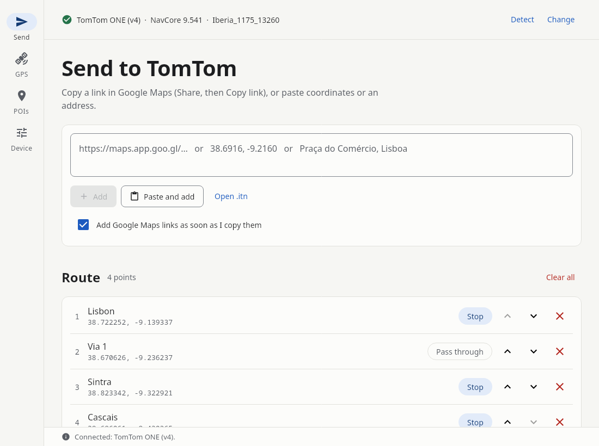
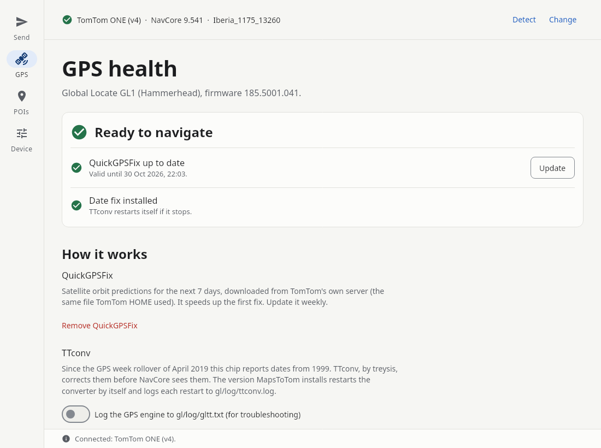
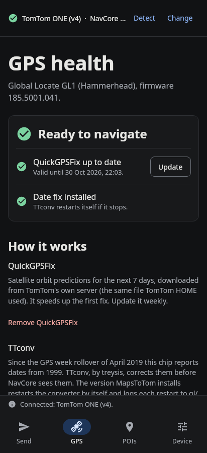

# MapsToTom

Send places and routes from Google Maps to an old TomTom, and keep its GPS working.
For TomTom ONE, XL, GO and Rider models that show up as a USB drive with a `ttgo.bif` file
(NavCore 8 and 9). Built and tested with a TomTom ONE v4 running NavCore 9.541.

One app for **Windows, macOS, Linux and Android**, with the same screens everywhere.

<p>
  
  
</p>
<p></p>

## Get it

Download the latest version from the [Releases page](https://github.com/skinnie/MapsToTom/releases):

| System | File | Notes |
|---|---|---|
| Windows | `MapsToTom-x.y.z.msi` | Windows may warn about an unknown publisher: *More info → Run anyway*. |
| macOS | `MapsToTom-x.y.z.dmg` | Not signed: the first time, right-click the app → *Open*. |
| Linux | `mapstotom_x.y.z_amd64.deb` | `sudo apt install ./mapstotom_*.deb` |
| Android 8+ | `MapsToTom-android.apk` | Allow "install unknown apps" for your browser or file manager. |

The desktop versions include their own Java runtime; nothing else is needed.

## Connect the TomTom

- **Computer:** plug it in by USB. MapsToTom finds it by itself (or press **Choose…**).
- **Android tablet or phone:** plug the TomTom in with a USB OTG adapter. When Android shows the
  TomTom drive, press **Choose…** in MapsToTom and pick the drive. Android remembers the choice.
  The tablet must supply power over USB, and the TomTom must accept it as a computer: try it
  first in the Files app.

Always eject the TomTom (or switch it off) before unplugging it.

## Send places and routes

1. In Google Maps, make a route or open a place, then **Share**.
   - **Android:** choose **MapsToTom** in the share menu.
   - **Computer:** choose *Copy link*. With "Add Google Maps links as soon as I copy them" ticked,
     the link is added at once. Or paste it into the box and press **Add**.
2. Edit the list: reorder, rename (tap the name), switch Stop/Via, remove.
3. Save:
   - **Save route (Itinerary)** writes `itn/<name>.itn`.
     On the TomTom: *Itinerary planning → Options → Load itinerary*.
   - **Save as POIs** adds the stops to a POI category (default "Google Maps") in the active map,
     with a pin icon. Points already in it are skipped.
     On the TomTom: *Navigate to → Point of Interest*.
   - **Export .itn…** saves the itinerary anywhere.

| Input | Example |
|---|---|
| Short link (also from the phone app) | `https://maps.app.goo.gl/…` |
| Directions, with stops and dragged via points | `https://www.google.com/maps/dir/Lisbon/Sintra/…/data=…` |
| Place | `https://www.google.com/maps/place/Torre+de+Belém/…` |
| Place ID, API and old-style links | `?cid=…`, `…/dir/?api=1&origin=…&destination=…`, `?q=38.7,-9.1` |
| Coordinates | `38.6916, -9.2160` or `38°41'29.8"N 9°12'57.6"W` |
| Address | `Praça do Comércio, Lisboa` (looked up on OpenStreetMap) |

**Same roads as Google:** Google links hold only the stops and dragged points, not the road
shape, so the TomTom plans its own route between them. Tick **Follow the same roads** to add
pass-through points along the road (from the public OSRM router, OpenStreetMap data).
Older TomToms may not load more than 48 points.

## GPS tools

The **GPS** tab works out which GPS chip the TomTom has and offers what that chip needs.

| Chip | Typical models | QuickGPSFix | 2019 date fix |
|---|---|---|---|
| Global Locate GL1 (Hammerhead) | ONE v4, ONE 3rd ed., XL | `lto.dat` | **TTconv** (installed by MapsToTom) |
| Broadcom BCM4750 / GL2 (Barracuda) | GO x50, GO 950 | `lto.dat` | **glgps from NavCore 9.541** (you supply it) + **clock fix** |
| SiRFstarIII | GO x10–x40, older ONE | `packedephemeris.ee` | GPS firmware 3.2.5 / 3.6.0 (shown, not flashed) |
| Atheros AR1520 | Rider 2013 | — | TTconv |

- **QuickGPSFix** downloads the 7-day satellite orbit prediction from TomTom's own server (the
  same file TomTom HOME uses) and installs it. MapsToTom updates it by itself when the TomTom is
  connected and it expires within a day (can be switched off), and on Android reminds you the
  day before it runs out.
- **TTconv** (by treysis) corrects the date the GPS reports after the April 2019 week rollover.
  MapsToTom's version restarts the converter by itself when it stops, which is when the TomTom
  seems to lose the satellites, and logs each restart to `gl/log/ttconv.log`.
- **glgps 9.541**: Broadcom units are fixed by NavCore 9.541's GPS driver
  (Broadcom GLL 2.16.201). MapsToTom can't include it; choose it from your own NavCore files and
  MapsToTom checks it before installing. The old one is kept as `bin/glgps.orig`.
- **Clock fix** (Broadcom units): old TomToms lose their internal clock, and this GPS engine
  starts from it. With QuickGPSFix it then looks for satellites in the wrong place and never
  gets a fix (deleting QuickGPSFix "fixes" it). The clock fix tells the engine to take the time
  from the satellites first. It is built from the TomTom's own system files and written to
  `gl/cfg/glconfig.xml`; remove it to undo.

## Routes from GPX

**Open .itn or .gpx** on the Send screen loads a route from Komoot, Strava, RideWithGPS or any
GPX file. The line is cut down to the 48 points older TomToms load, keeping the points that
shape it most (tested on real rides: at most about 200 m off the original line). Start and
finish are stops; the rest are pass-through points the TomTom follows without announcing.

## POIs

- **From OpenStreetMap:** fuel stations, LPG stations, EV chargers, motorhome areas, campsites,
  supermarkets, pharmacies and speed cameras, for the countries of your map. Each type becomes
  its own category with an icon; speed cameras also get a warning beep. Downloads use the
  public Overpass servers, which are often busy: MapsToTom tries several. Speed cameras can't
  be installed for France, where warning of camera positions is illegal.
- **Your Google Maps lists:** export "Saved" and "Maps (your places)" at
  [Google Takeout](https://takeout.google.com) and open the .zip. Each list (and your starred
  places) becomes a category "Google <list>". Places saved without coordinates are looked up.
- **From a Garmin POI file (.gpi):** files like iOverlander or camper POI packs. Pick the
  categories you want; each becomes a TomTom category named after the file ("iOverlander Wild
  Camping") with the file's own icon. By default only places inside your map's countries are
  kept. Encrypted GPIs (some paid add-ons) can't be read. GPSBabel 1.9 can't read newer files
  like iOverlander's and no longer writes `.ov2`, so this reader is MapsToTom's own.
- **On the TomTom:** every category with its number of places, the year of the file, and a
  note when the map already has a similar built-in category (old fuel or hotel lists usually
  repeat what the map has, with older data). Open a category to rename or delete single places;
  the first change keeps the original as `<name>.ov2.mapstotom-backup`. TomTom's encrypted
  services (like Safety Cameras) are shown as protected and left alone.
- **From a folder:** `.ov2` files with a `.bmp` icon and an `.ogg` warning sound of the same name.

## Device tools

- **Power button:** choose between standby (default) and switching fully off (`suicide.dat`).
- **Car power:** stop the 10-second "switching off" countdown that weak USB ports (like a car
  radio's) trigger when power dips (`noautosuspend.dat`). The TomTom then no longer switches off
  with the car.
- **Backup / restore:** copy everything on the TomTom to a folder, and put it back.

Every change keeps the replaced file (`.orig`, `.mapstotom-backup`) so it can be undone.

## Online services

- **Google:** short links are followed to the full link; for links without coordinates
  (phone shares, place IDs) the place details are read from Google Maps, with cookie consent
  set to "reject all".
- **OpenStreetMap Nominatim:** addresses, and a fallback when Google gives no answer
  (at most one request per second).
- **OSRM demo server:** only for "Follow the same roads".
- **Overpass API (OpenStreetMap):** POI downloads. Reverse lookups on Nominatim name points
  that are only coordinates.
- **TomTom** (`home.tomtom.com`): QuickGPSFix. Its certificate chains to the old
  "DigiCert High Assurance EV Root CA", which current systems no longer trust; MapsToTom trusts
  that one root for tomtom.com only (SHA-256 `74:31:E5:F4:…:B1:18:CF`).

## File formats

- **`.itn`**: one line per point, `lon|lat|name|flag|`, coordinates ×100000, Windows-1252 text.
  Flag 4 = departure, 2 = stop or destination, 0 = pass-through.
- **`.ov2`**: type-2 records: type byte, record length, longitude and latitude ×100000
  (little-endian), zero-terminated name.
- **`.gpi`** (read only): a tree of records `u16 type, u16 flags, u32 size` (+ `u32` own-data
  size when flags & 8). Group 9 → areas 8 → places 2 (lat/lon in semicircles, name, category
  ref 6); categories 7 and bitmaps 5 hang off the group. Text is a list of language-tagged
  strings; the code page is in record 1.

## Build it yourself

Needs JDK 17. For Android, also the Android SDK (`local.properties` with `sdk.dir=…`).

```bash
./gradlew :composeApp:run                              # run the desktop app
./gradlew :composeApp:desktopTest                      # tests (add -Pm2t.online=1 for live TomTom download)
./gradlew :composeApp:packageDistributionForCurrentOS  # .msi / .dmg / .deb for this system
./gradlew :composeApp:assembleDebug                    # Android APK
```

`MAPSTOTOM_DEVICE=/path/to/folder` makes the desktop app open a copy of a TomTom's files,
for testing without the device.

`./gradlew :composeApp:desktopTest --tests app.mapstotom.ScreenshotTest -Pm2t.shots=out -Pm2t.device=/path/to/copy`
renders every screen, light and dark, desktop and phone width, to PNG without a display.

The UI follows one token theme (`ui/Theme.kt`): one accent colour, warm neutrals, a 4 dp spacing
scale and one radius language. Every text colour pair was measured against WCAG 2.2 AA in both
themes. Status is always an icon plus words, and destructive actions are red on the trigger and
the confirmation alike.

The code is Kotlin with Compose Multiplatform. The app logic (`composeApp/src/jvmSharedMain`)
is shared by desktop and Android; only file pickers and USB access differ.

## Credits and licences

- MapsToTom: MIT licence (see `LICENSE`).
- [TTconv](https://github.com/treysis/TTconv) by treysis: GPL-3.0. Included unchanged, except the
  two start scripts described in `composeApp/src/commonMain/composeResources/files/ttconv/NOTICE.txt`.
- Map data lookups: © OpenStreetMap contributors (Nominatim, OSRM).
- MapsToTom does not activate or unlock maps.
